<div align="center">



<br>

<a href="https://naveenr.in">naveenr.in</a> · <a href="https://linkedin.com/in/naveen-r-cud">LinkedIn</a> · <a href="mailto:naveenrameshcud@gmail.com">Email</a>
<br>


</div>

<br>

<details open>
<summary><code>~$ cat about.md</code></summary>
<br>

Full Stack Engineer building robust, scalable, high-performance systems — with depth in **backend architecture** (distributed systems, microservices, concurrency control) and **modern frontend engineering**.

- Strong foundation in System Design, DDD, SOLID, and Cloud Infrastructure
- Currently advancing in Cloud-Native Architecture, Distributed Systems, and AI/ML at scale
- B.E. in Electronics and Communication Engineering

</details>

<details open>
<summary><code>~$ cat stack.txt</code></summary>
<br>

```
language   TypeScript · JavaScript · Kotlin · Java
frontend   React · Next.js · Tailwind CSS · Redux · TanStack Query · Zustand
backend    Spring Boot · NestJS · Node.js · JWT · Consul
database   PostgreSQL · MongoDB · Liquibase
devops     Docker · GitHub Actions · Git
testing    Jest · Vitest · JUnit5
```

</details>

<br>

<code>~$ ls pinned/</code>
&nbsp;&nbsp;→ pinned repos are up on the profile ↑ — **[Min-Mozhi](https://github.com/Naveen2070)** and more live there, not duplicated here.

<br>

<div align="center">


<br><br>

</div>

<br>

<div align="center">
  <code>[naveen@github ~]# echo "It's not a bug, it's an undocumented feature."</code>
</div>
